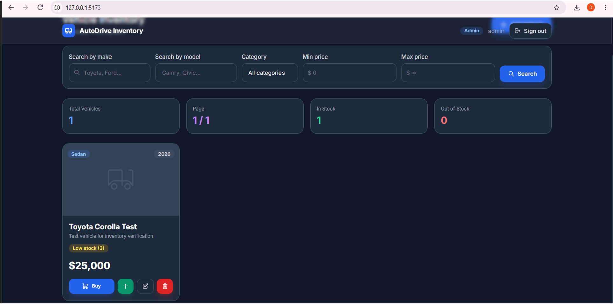
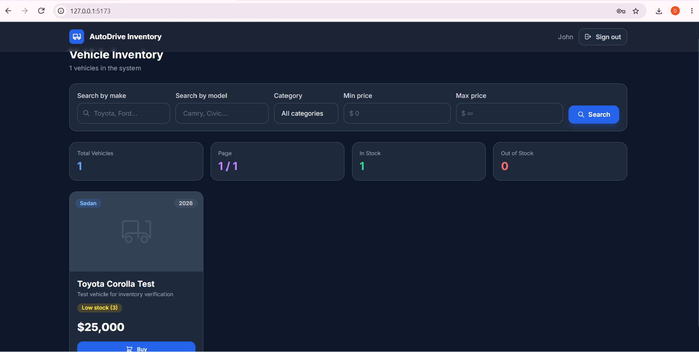
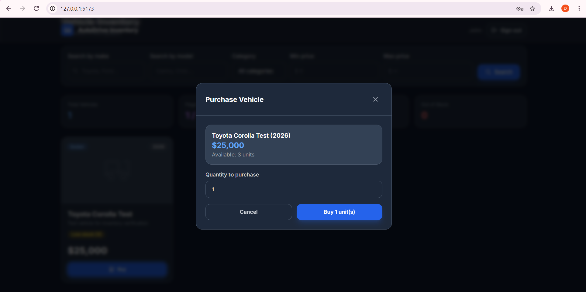

# Car Dealership Inventory Management System

A full-stack web application for managing a car dealership's vehicle inventory, built with Node.js/TypeScript (backend) and React/TypeScript (frontend), following Test-Driven Development methodology.

---

## Table of Contents

- [Overview](#overview)
- [Features](#features)
- [Tech Stack](#tech-stack)
- [Architecture](#architecture)
- [Getting Started](#getting-started)
- [API Reference](#api-reference)
- [Test Results](#test-results)
- [Project Structure](#project-structure)
- [Application Screenshots](#application-screenshots)
- [My AI Usage](#my-ai-usage)

---

## Overview

This system allows car dealership staff to:
- Register and authenticate with role-based access (User / Admin)
- Browse the full vehicle inventory with pagination
- Search and filter vehicles by make, model, category, and price range
- Purchase vehicles (reduces stock)
- Restock vehicles (Admin only)
- Add, edit, and delete vehicles from the inventory (Admin: add/edit/delete; Users: browse/purchase)

---

## Features

### Authentication
- User registration with email, username, password validation
- Admin role assignment via secure admin code
- JWT-based authentication (24-hour default expiry, configurable)
- Protected routes (middleware-enforced)
- Password hashing with bcrypt (10 rounds)

### Vehicle Inventory
- Full CRUD operations for vehicles (admin-only create, update, and delete)
- 7 vehicle categories: Sedan, SUV, Truck, Coupe, Van, Electric, Hybrid
- Stock tracking (quantity management)
- Purchase flow with stock validation
- Admin-only restock, create, update, and delete operations
- Server-side pagination (configurable page size)
- Multi-filter search (make, model, category, price range) with case-insensitive partial match

### Frontend UI
- Dark-themed responsive design with Tailwind CSS
- Login / Register pages with validation feedback
- Vehicle grid with stock status indicators
- Search/filter bar with live filtering
- Inventory statistics panel
- Modal dialogs for add/edit/delete/purchase/restock
- Toast notifications for user feedback
- Pagination component
- Skeleton loading states
- Admin-only controls visible conditionally

---

## Application Screenshots

### Admin Vehicle Management

The admin dashboard displays inventory totals and the admin-only controls for restocking, editing, and deleting a vehicle.



### Regular User Dashboard

The regular-user dashboard displays inventory and the purchase action without admin management controls.



### Regular User Purchase

The purchase dialog shows the selected vehicle, its available stock, and the requested purchase quantity.



---

## Tech Stack

### Backend
| Technology | Purpose |
|------------|---------|
| Node.js v22 | Runtime |
| Express 4 | HTTP framework |
| TypeScript | Type safety |
| SQLite (via `sqlite` + `sqlite3`) | Database (no native compile required) |
| JWT (jsonwebtoken) | Authentication tokens |
| bcrypt | Password hashing |
| Zod | Request validation |
| Jest + Supertest | TDD test framework |
| ts-jest | TypeScript Jest transformer |

### Frontend
| Technology | Purpose |
|------------|---------|
| React 19 | UI library |
| Vite 8 | Build tool / dev server |
| TypeScript 6 | Type safety |
| Tailwind CSS 3 | Styling |
| Context API | Auth state management |
| Fetch API | HTTP client |

---

## Architecture

```
Car_Dealership_Inventory/
├── backend/                    # Express API server
│   ├── src/
│   │   ├── @types/             # Express type extensions
│   │   ├── config/database.ts  # SQLite singleton with schema init
│   │   ├── controllers/        # Auth & Vehicle controllers
│   │   ├── middleware/         # JWT auth, admin guard, error handler
│   │   ├── models/             # UserModel, VehicleModel (async)
│   │   ├── routes/             # Auth & Vehicle route definitions
│   │   ├── utils/              # JWT helpers, Zod validators
│   │   ├── app.ts              # Express app configuration
│   │   └── server.ts           # HTTP server entry point
│   └── tests/                  # Jest + Supertest TDD suites
│       ├── auth.test.ts        # 17 tests
│       ├── vehicles.test.ts    # 25 tests
│       ├── inventory.test.ts   # 13 tests
│       └── health.test.ts      # 3 tests
│
└── frontend/                   # React + Vite SPA
    └── src/
        ├── components/
        │   ├── auth/           # LoginForm, RegisterForm
        │   ├── vehicles/       # VehicleCard, VehicleForm, SearchFilterBar
        │   ├── ui/             # Modal, Pagination
        │   ├── AuthPage.tsx    # Authentication page
        │   └── Dashboard.tsx   # Main inventory dashboard
        ├── context/
        │   └── AuthContext.tsx # Global auth state (React Context)
        ├── hooks/
        │   └── useVehicles.ts  # Vehicle data & actions hook
        └── lib/
            └── api.ts          # Typed API client (fetch-based)
```

### Database Schema

```sql
CREATE TABLE users (
  id INTEGER PRIMARY KEY AUTOINCREMENT,
  username TEXT UNIQUE NOT NULL,
  email TEXT UNIQUE NOT NULL,
  password TEXT NOT NULL,          -- bcrypt hash
  role TEXT DEFAULT 'user'         -- 'user' | 'admin'
    CHECK(role IN ('user', 'admin')),
  created_at DATETIME DEFAULT CURRENT_TIMESTAMP
);

CREATE TABLE vehicles (
  id INTEGER PRIMARY KEY AUTOINCREMENT,
  make TEXT NOT NULL,
  model TEXT NOT NULL,
  year INTEGER NOT NULL,
  category TEXT NOT NULL
    CHECK(category IN ('Sedan','SUV','Truck','Coupe','Van','Electric','Hybrid')),
  price REAL NOT NULL CHECK(price > 0),
  quantity INTEGER NOT NULL DEFAULT 0 CHECK(quantity >= 0),
  description TEXT DEFAULT '',
  image_url TEXT DEFAULT '',
  created_at DATETIME DEFAULT CURRENT_TIMESTAMP,
  updated_at DATETIME DEFAULT CURRENT_TIMESTAMP
);
```

---

## Getting Started

### Prerequisites
- Node.js >= 18
- npm

### Backend Setup

```bash
cd backend
npm install
cp .env.example .env
# Set private JWT_SECRET and ADMIN_REGISTRATION_CODE values in .env.
npm run dev
```

The backend runs on **http://localhost:5000**. The first start creates an empty SQLite database; an admin account must add vehicles before they appear in inventory.

### Frontend Setup

```bash
cd frontend
npm install
npm run dev
```

The frontend dev server runs on **http://localhost:5173** and proxies `/api` requests to the backend on port `5000`.
For a deployed frontend, set `VITE_API_URL` to the backend API base URL ending in `/api` before building.

### Environment Variables (backend/.env)

Use `backend/.env.example` as a template. Set `JWT_SECRET` to a private random value of at least 32 characters and choose a private `ADMIN_REGISTRATION_CODE`. The server refuses to start without `JWT_SECRET`; admin registration is unavailable until an admin code is configured. Never commit the real `.env` file.

---

## API Reference

Vehicle endpoints and `/api/auth/me` require `Authorization: Bearer <token>`. Registration, login, and `/api/health` are public.

### Auth Endpoints

| Method | Path | Auth | Description |
|--------|------|------|-------------|
| `POST` | `/api/auth/register` | None | Register new user |
| `POST` | `/api/auth/login` | None | Login and get JWT |
| `GET` | `/api/auth/me` | Required | Get current user profile |

**Register Request:**
```json
{
  "username": "johndoe",
  "email": "john@example.com",
  "password": "securepassword",
  "role": "admin",        // optional
  "adminCode": "SECRET"   // required if role is admin
}
```

### Vehicle Endpoints

| Method | Path | Auth | Role | Description |
|--------|------|------|------|-------------|
| `GET` | `/api/vehicles` | Required | Any | List vehicles (paginated) |
| `GET` | `/api/vehicles/search` | Required | Any | Search with filters |
| `GET` | `/api/vehicles/:id` | Required | Any | Get vehicle by ID |
| `POST` | `/api/vehicles` | Required | **Admin** | Add new vehicle |
| `PUT` | `/api/vehicles/:id` | Required | **Admin** | Update vehicle |
| `DELETE` | `/api/vehicles/:id` | Required | **Admin** | Delete vehicle |
| `POST` | `/api/vehicles/:id/purchase` | Required | Any | Purchase (decrement stock) |
| `POST` | `/api/vehicles/:id/restock` | Required | **Admin** | Restock (increment stock) |

**Search Query Parameters:**
- `make` — partial, case-insensitive text match
- `model` — partial, case-insensitive text match
- `category` — exact match (`Sedan`, `SUV`, etc.)
- `minPrice` / `maxPrice` — numeric range
- `page` / `limit` — pagination

---

## Test Results

See [TEST_REPORT.md](./TEST_REPORT.md) for the current verified backend and frontend test results.

Run tests:
```bash
cd backend
npm test
```

```bash
cd frontend
npm test
```

Run backend coverage from the backend folder:
```bash
cd backend
npm run test:coverage
```

---

## Project Structure

```
backend/
├── data/                    # SQLite DB files (gitignored)
├── src/
│   ├── @types/
│   │   └── express.d.ts     # Extends Express Request with user payload
│   ├── config/
│   │   └── database.ts      # connectDB / getDB / closeDB singleton
│   ├── controllers/
│   │   ├── auth.controller.ts
│   │   └── vehicle.controller.ts
│   ├── middleware/
│   │   └── auth.middleware.ts  # authenticate, requireAdmin, validate, errorHandler
│   ├── models/
│   │   ├── user.model.ts
│   │   └── vehicle.model.ts
│   ├── routes/
│   │   ├── auth.routes.ts
│   │   └── vehicle.routes.ts
│   ├── utils/
│   │   ├── jwt.ts
│   │   └── validators.ts
│   ├── app.ts
│   └── server.ts
└── tests/
    ├── auth.test.ts
    ├── inventory.test.ts
    ├── setup.ts
    └── vehicles.test.ts
```

---

## Submission Status

This project is available as a public GitHub repository:

[Car Dealership Inventory Management System](https://github.com/Devesh831/Car-Dealership-Inventory)

A live deployment is optional.

## My AI Usage

This project used **Antigravity AI** (Google DeepMind) during the original implementation and **OpenAI Codex** for the current audit, fixes, tests, and documentation review. The existing AI-assisted commits include this trailer:

```
Co-authored-by: Antigravity AI <antigravity@users.noreply.github.com>
```

See [`PROMPTS.md`](./PROMPTS.md) for the complete, unedited AI conversation logs.

The tools were used for architecture discussion, test design, backend and frontend implementation, debugging, and documentation. This review used them to compare the current code to the assignment, implement the authorization and API configuration fixes, add tests, and correct the project documentation. The historical prompt log remains unchanged.

AI assistance sped up code review and repetitive implementation work. The changes were checked against the assignment and verified with the documented test and build commands. No inventory records, screenshots, commit timestamps, or conversation logs were fabricated.
